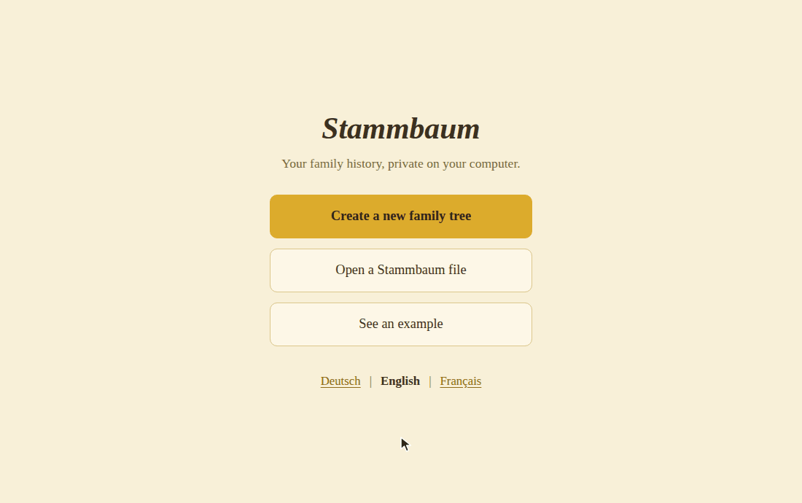

# Stammbaum – offline family-tree app

A private, self-contained web app to **create, edit and view family trees**. Made for families who want to collect
their history without an account, a cloud or a genealogy program.



- Runs **fully offline** in a normal desktop browser (Chrome, Edge, Firefox, Safari) on Windows, Linux and macOS.
- Ships as a **zip you can email**: unzip, double-click `Stammbaum.html`, done. No installation.
- **No data ever leaves the device.** The whole tree, photos included, lives in one project file (`*.stammbaum`)
  that you save, copy and pass on like any document.
- App languages: **German, English and French** (chosen on the start screen, remembered per browser).

## What it can do

- A tree that lays itself out: pan, zoom, select a person to light up their line and see the details.
- Real-life families: remarriage, divorce, adoption, unknown parents. Rare cases only show up where they exist.
- Vague dates ("about 1850", "before 1900"), photos with cropping, free extra fields.
- Undo for everything, autosave to the browser, print or save the whole tree as a PDF, help inside the app.
- Built for the "grandma test": large buttons, plain words, every detail optional.

> Status: version 0.12.0 is a test version for family members. Next: manual checks on a real Mac and Windows
> ([docs/manual-checks.md](docs/manual-checks.md)) and feedback, then 1.0.0.
> The current state is always in [docs/agent/HANDOVER.md](docs/agent/HANDOVER.md).

## How it is built

Svelte 5 and TypeScript, bundled by Vite into a single HTML file. A strict Content-Security-Policy makes the browser
itself block every network access. Unit tests (Vitest) cover the logic; browser tests (Playwright) click through the
built file in Chromium, Firefox and WebKit. The app is developed mostly by AI coding agents (Claude Code) along an
agreed requirements catalogue, with a human product owner. So the repo carries its own context:
[CLAUDE.md](CLAUDE.md), requirements, ADRs, a handover note.

| You want to …                           | Go to                                                                  |
| --------------------------------------- | ---------------------------------------------------------------------- |
| See what the app must do (the contract) | [docs/requirements/REQUIREMENTS.md](docs/requirements/REQUIREMENTS.md) |
| Understand how it is built              | [docs/concept/](docs/concept/)                                         |
| Know why a technical choice was made    | [docs/agent/decisions/](docs/agent/decisions/)                         |
| Read all docs in one overview           | [docs/README.md](docs/README.md)                                       |

## Developer quick start

Prerequisite: Node.js (version in `.nvmrc`, installed via [nvm](https://github.com/nvm-sh/nvm)). End users only need the built HTML file.

```bash
nvm use            # select the pinned Node version
npm install        # install dev tools + activate the git pre-push hook
npm run dev        # live-reloading dev server for development
npm run verify     # everything the pre-push hook checks (types, lint, tests, build)
npm run package    # build the distributable zip into release/
```

See [docs/README.md](docs/README.md) for the full list of commands.

## Licence and contact

[MIT](LICENSE). The bundled libraries (Svelte, fflate) are MIT-licensed too; their licence texts ship in the zip as
`LICENSES.txt`. Questions or ideas: bimo3000@posteo.com.
