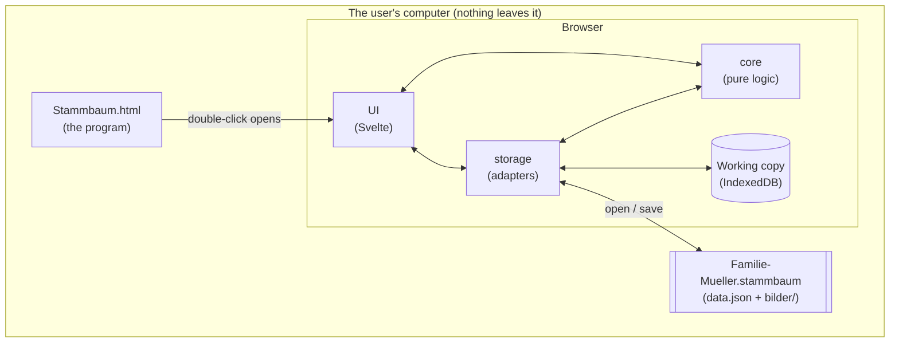
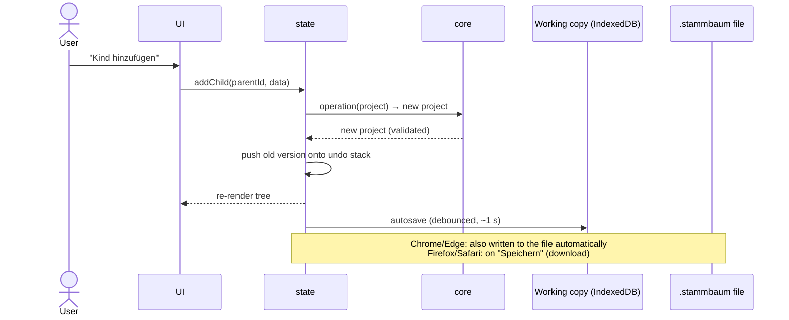

# Architecture concept

> Status: **aligned with the user** (2026-10-24). Decisions marked ✅ are aligned. See the decisions section at the end.

## 1. The big picture

Stammbaum is **one HTML file** containing the whole program. The user's family data lives **outside** that file, in
project files (`*.stammbaum`). While the app is open, it also keeps an automatic working copy inside the browser.

Analogy: `Stammbaum.html` is like a word processor and the `.stammbaum` file is like a document. You can email either one
on its own, and you can open the document with any copy of the program.

## 2. Layers and their rules

| Layer       | Folder          | Contains                                                                                                                                               | Rules                                                                                                                                 |
| ----------- | --------------- | ------------------------------------------------------------------------------------------------------------------------------------------------------ | ------------------------------------------------------------------------------------------------------------------------------------- |
| **core**    | `src/core/`     | Data model types, operations (add person, link parent, …), validation, flexible dates, tree layout, data-format migrations, serialization to/from JSON | Pure TypeScript with **no browser APIs** (lint-enforced). Every function is unit-tested. It has no idea that a UI exists.             |
| **storage** | `src/storage/`  | Reading/writing `.stammbaum` zip files, the browser working copy, the "last project" pointer, picture import and downscaling                           | The only layer that touches files, IndexedDB, file pickers and canvas. Hidden behind small interfaces so it can be tested with fakes. |
| **state**   | `src/ui/state/` | The currently open project, selection, undo/redo history, save status                                                                                  | Thin glue. Every change goes through a core operation.                                                                                |
| **ui**      | `src/ui/`       | Svelte components: tree view, person card, detail panel, forms, dialogs                                                                                | All German texts live here, and only here. User text is always rendered as text, never as HTML.                                       |

The dependency direction is strictly `ui → state → core` and `storage → core`. Core depends on nothing.
This is what keeps **data separate from logic** (DATA-01) and makes a future read-only website (FUT-01) a matter of
leaving out the editing UI.

### How a change flows

Every change is a **pure function** `project → new project`. That makes undo/redo trivial (UI-01): we keep the previous
versions. With ~100 persons a project is a few hundred kB of JSON (pictures are stored separately), so keeping 100 undo steps is cheap.

## 3. Storage ✅ (format aligned, details below)

### 3.1 The project file `*.stammbaum`

- It is a **zip file** with a custom extension, so it travels as one file. Safari doesn't auto-extract it, and it opens
  with any copy of Stammbaum.
- It contains `data.json` (all persons and relations, see [data-model.md](data-model.md)) and `bilder/` (one JPEG per picture).
- Pictures are already compressed, so they are stored as-is. Only `data.json` is compressed.
- Zip library: **fflate** (small, no dependencies, widely used, bundled into the HTML). It gets added when storage is
  implemented (ADR-0005).

### 3.2 The working copy and "last project" (DATA-03)

- After every change the open project is autosaved into the browser's built-in database (IndexedDB), pictures included.
- At startup the app reopens the last project from there, so the user continues where they left off.
- The working copy is a **safety net and a convenience. The `.stammbaum` file is the real thing.** The working copy
  disappears if the user clears the browser data, and it is tied to that one browser on that one computer.

**Verified by a spike (2026-10-24), Playwright on Linux:**

|                                                           | Chromium (Chrome/Edge) | Firefox               | WebKit (≈ Safari)     |
| --------------------------------------------------------- | ---------------------- | --------------------- | --------------------- |
| IndexedDB incl. pictures under `file://`                  | ✅                     | ✅                    | ✅                    |
| Survives a browser restart                                | ✅                     | ✅                    | ✅                    |
| Survives moving/renaming `Stammbaum.html`                 | ✅                     | ✅                    | ✅                    |
| Save directly into a chosen file (File System Access API) | ✅                     | ❌ (download instead) | ❌ (download instead) |

Note: browsers treat **all local HTML files as one shared storage area**. That is why moving the file works. It also means
another local HTML file opened in the same browser could, in theory, read the working copy. The risk is low (the data
never leaves the device), and it is documented here for transparency. A real Safari on macOS still needs a manual check.

### 3.3 Saving and opening per browser

| Action              | Chrome / Edge                                                                                              | Firefox / Safari                                                                                       |
| ------------------- | ---------------------------------------------------------------------------------------------------------- | ------------------------------------------------------------------------------------------------------ |
| **Open**            | File picker, or drag & drop the file onto the window                                                       | File picker, or drag & drop                                                                            |
| **First save**      | "Speichern unter …" dialog, user picks name and folder                                                     | The file is downloaded as `Name.stammbaum` (normally into the Downloads folder)                        |
| **Later saves**     | Automatically into the same file after every change ✅ (DATA-09)                                           | "Speichern" downloads a new version. The browser may add `(1)` to the name. A hint explains this once. |
| **After a restart** | Working copy restored. Writing to the file needs one click ("Erlaubnis erneuern"), a browser security rule | Working copy restored                                                                                  |

The UI always shows the save status ("✓ Gespeichert" / "● Nicht in Datei gespeichert") (UI-02).

### 3.4 Pictures

- Imported via file picker or drag & drop.
- Automatically downscaled ✅ (DATA-07) to max. **2000 px** on the long side, JPEG quality ~0.85, giving about 300–600 kB per picture.
  100 persons with pictures then come to about 30–60 MB per project file. That is fine for backups and USB sticks, but
  too big for many email providers, so proposal P-008 suggests a "Kopie zum Verschicken" export with smaller pictures.
- Displayed via `blob:` URLs, which the CSP allows.
- iPhone HEIC photos only decode in Safari. Other browsers show a friendly message ("Bitte als JPG speichern").

## 4. Tree view and layout

- **Rendering:** SVG, which is sharp at any zoom level and easy to test. Person cards are SVG groups (photo, name, dates).
  Pan/zoom is our own small implementation (drag, mouse wheel, `+`/`−`, "Alles anzeigen"). No library is needed.
- **Layout algorithm:** our own, in `src/core/layout/` (ADR-0006). Pure functions, so it is unit-testable with fixture families.
  1. **Generations:** each person gets a row. Partners share a row, and children sit one row below their parents.
  2. **Family units:** a couple plus their children is drawn as one unit. Children hang from the couple's connecting line.
  3. **Order within a row:** siblings by birth date, and families arranged so that lines cross as little as possible.
  4. **Positions:** parents centered above their children, with no overlaps and compact spacing.
- **Special cases (progressive disclosure, TREE-04):**
  - Multiple partners: the person stands between or next to their partners, each with their own children.
  - Adoption/step/foster: a dashed line, drawn only where it applies.
  - Unknown parent: the child hangs from the single known parent.
  - Cousin marriages and other loops: the layout must not break. One person may then have a long connecting line.
- **Focus (TREE-02):** clicking a person highlights their ancestors and descendants and slightly fades everyone else.
  Double-click centers on them.
- **Performance:** 100 persons is small. The layout is recomputed fully on every change, which is simpler and safe (TREE-05).

## 5. Data format versioning (DATA-08)

- `data.json` carries `"format": "stammbaum"` and a `schemaVersion` number.
- `src/core/migrations/` holds one small upgrade function per version step (v1→v2, v2→v3, …). Older files are upgraded on open,
  and each step has a unit test with a stored sample file.
- A file **newer** than the app gets the message "Diese Datei wurde mit einer neueren Version erstellt", plus a read-only view where possible.

## 6. Privacy design (PRIV-01/02) ✅

Summarized from ADR-0003: the browser itself forbids every network connection (CSP). This is backed up by a lint rule,
a build check and E2E tests. No fonts or icons are loaded from the internet. We use system fonts and inline SVG icons.
Agents don't read real family data either (`data/` is denied in `.claude/settings.json`).

## 7. Robustness

- **Unexpected errors:** a friendly German message ("Etwas ist schiefgelaufen. Deine Daten sind sicher.") with a button to reload.
  The working copy is saved before risky operations.
- **Two tabs with the same project:** detected locally (`BroadcastChannel`, no network). The second tab warns and opens read-only.
- **Closing with unsaved changes:** the browser's standard "Seite verlassen?" prompt (Firefox/Safari, when the file is outdated).
- **IDs:** random, generated with `crypto.randomUUID()`, which is available under `file://` in all engines (checked in the spike).

## 8. Future: read-only website (FUT-01)

The same code base gets a second build target, `npm run build:viewer`, which:

- leaves out all editing components (they are not even in the file),
- embeds one project (data + pictures) directly, or loads a `.stammbaum` placed next to it,
- produces a static page that can go on any web host.

Privacy note for later: a static website is **public**. Whether living persons should be hidden or anonymized is a
requirement to decide when FUT-01 comes up.

## 9. Browser support

Current versions of Chrome, Edge, Firefox and Safari (desktop) at the time of each release. Older browsers are not tested.
JavaScript must be enabled (a `<noscript>` message explains this).

## Decisions (aligned with the user on 2026-10-24)

1. **Auto-save into the file (Chrome/Edge):** yes. After the first "Speichern unter …", every change goes straight into the file (DATA-09).
2. **Picture size:** max. 2000 px (DATA-07). The user chose quality over file size. For emailing, see proposal P-008.
3. **Firefox/Safari saving via download:** accepted, with a one-time hint and the save status (DATA-09, UI-02).
