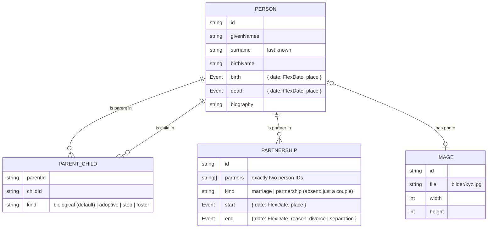

# Data model concept

> Status: **aligned with the user** (2026-10-24). See the decisions section at the end.

## 1. Idea in one paragraph

A project holds three lists: **persons**, **partnerships** (two persons belong together) and **parent-child links**
(this person is a parent of that person). Everything else is derived from these, e.g. siblings, grandparents and
"children of this marriage". **Every field except the internal ID is optional** (PERS-02). Rare details (adoption, divorce, …) are
simply absent unless used, so the file stays as simple as the family (TREE-04).



Why links rather than "family" records (the way GEDCOM does it)? Links handle the common real-world gaps naturally:
one parent unknown, an adoptive parent added later, children from several partners. "Families" for drawing are
**derived**: a child whose two parents are partners hangs under that couple. A GEDCOM export (FUT-03) can produce
family records from this.

## 2. Person fields

Shown **on the card** (PERS-04): photo, name (`givenNames` + `surname`), birth and death dates.
Shown **on hover/click** (PERS-05): everything else that is filled in.

| Field                       | German label      | Notes                                                                                                                |
| --------------------------- | ----------------- | -------------------------------------------------------------------------------------------------------------------- |
| `givenNames`                | Vornamen          | All first names, e.g. "Anna Maria"                                                                                   |
| `callName`                  | Rufname           | Optional. Highlighted (underlined) in the name if set                                                                |
| `surname`                   | Nachname          | **Last known** surname (PERS-04)                                                                                     |
| `birthName`                 | Geburtsname       | Shown as "geb. Schmidt"                                                                                              |
| `gender`                    | Geschlecht        | `female` / `male` / `diverse` / unknown. Optional, used for wording only (PERS-07)                                   |
| `birth.date`, `birth.place` | Geboren am / in   | Flexible date (see §4)                                                                                               |
| `death.date`, `death.place` | Gestorben am / in |                                                                                                                      |
| `deceased`                  | verstorben        | Only needed if the death date is unknown but the person is dead (shows "†" without a date)                           |
| `occupation`                | Beruf             |                                                                                                                      |
| `residences`                | Wohnorte          | Free text, e.g. "Hamburg, ab 1960 Kiel"                                                                              |
| `biography`                 | Lebensgeschichte  | Longer free text, line breaks preserved                                                                              |
| `photoId`                   | Foto              | Reference to an image (one photo per person, PERS-03)                                                                |
| `extraFields`               | Weitere Angaben   | List of free label/value pairs (e.g. "Konfession: ev.", "Grab: Friedhof Ohlsdorf"), for everything we didn't foresee |

## 3. Relations

**Partnership**: two persons. Optional details (TREE-03), only shown when filled:

- `kind`: `marriage` (Ehe) / `partnership` (Partnerschaft). If absent, it is simply drawn as a couple.
- `start`: date and place (wedding).
- `end`: date and `reason`: `divorce` (geschieden) / `separation` (getrennt). The death of a partner needs no entry.
- Several partnerships per person are allowed. They are ordered by start date, otherwise by creation order.

**Parent-child link**: `parentId`, `childId` and an optional `kind`:

- If absent, it is **biological**, which covers 99 % of cases.
- `adoptive`, `step` or `foster` is drawn with a dashed line and a label on hover.

**Validation rules** (in `core/`, unit-tested):

- A person can't be their own ancestor (no loops in parent-child links).
- At most 2 biological parents per person. Further parents must be adoptive, step or foster.
- A partnership needs two different persons, and the same two persons can't have duplicate partnerships.
- Deleting a person removes their links and partnerships. Their children and partners stay.

**Plausibility hints** (P-006) never block anything. Examples: death before birth, a parent younger than 12 at the
child's birth, a person older than 110 without a death date.

## 4. Flexible dates (PERS-06) ✅

The user types one text field. The app understands it, shows how it was read ("→ 12. März 1923"), and stores both:

| Input (examples)                        | Stored                                      | Shown on card | Sort value |
| --------------------------------------- | ------------------------------------------- | ------------- | ---------- |
| `12.03.1923`, `12.3.1923`               | `{ "y": 1923, "m": 3, "d": 12 }`            | 12.03.1923    | 1923-03-12 |
| `03.1923`, `März 1923`                  | `{ "y": 1923, "m": 3 }`                     | 03.1923       | 1923-03    |
| `1923`                                  | `{ "y": 1923 }`                             | 1923          | 1923       |
| `ca. 1850`, `um 1850`, `~1850`          | `{ "y": 1850, "q": "about" }`               | ca. 1850      | 1850       |
| `vor 1900`                              | `{ "y": 1900, "q": "before" }`              | vor 1900      | 1900       |
| `nach 1900`                             | `{ "y": 1900, "q": "after" }`               | nach 1900     | 1900       |
| `zw. 1890 und 1895`, `1890–1895`        | `{ "y": 1890, "q": "between", "y2": 1895 }` | 1890–1895     | 1890       |
| anything unreadable, e.g. `Ostern 1923` | `{ "text": "Ostern 1923" }`                 | Ostern 1923   | none       |

Unreadable input is **kept as written** and never rejected. The app shows a gentle hint that it can't be used for sorting.
This maps 1:1 to GEDCOM date qualifiers (`ABT`, `BEF`, `AFT`, `BET … AND`).

## 5. The project file

`Familie-Mueller.stammbaum` is a zip containing:

```
data.json
bilder/
  img_8f3a….jpg
  img_19c2….jpg
```

`data.json` (abridged example, with fictional data):

```json
{
  "format": "stammbaum",
  "schemaVersion": 1,
  "id": "4f1c2a9e-…",
  "name": "Familie Müller",
  "createdAt": "2026-10-24T10:00:00Z",
  "modifiedAt": "2026-10-24T12:30:00Z",
  "savedWithAppVersion": "0.1.0",
  "persons": [
    {
      "id": "p_anna",
      "givenNames": "Anna Maria",
      "surname": "Müller",
      "birthName": "Schmidt",
      "birth": { "date": { "y": 1923, "m": 3, "d": 12 }, "place": "Kiel" },
      "death": { "date": { "y": 2001 } },
      "photoId": "img_8f3a",
      "biography": "Wuchs in Kiel auf …"
    },
    {
      "id": "p_karl",
      "givenNames": "Karl",
      "surname": "Müller",
      "birth": { "date": { "y": 1920, "q": "about" } }
    },
    { "id": "p_eva", "givenNames": "Eva", "surname": "Müller" }
  ],
  "partnerships": [
    {
      "id": "u_1",
      "partners": ["p_anna", "p_karl"],
      "kind": "marriage",
      "start": { "date": { "y": 1946, "m": 6 } }
    }
  ],
  "parentChild": [
    { "parentId": "p_anna", "childId": "p_eva" },
    { "parentId": "p_karl", "childId": "p_eva" }
  ],
  "images": [{ "id": "img_8f3a", "file": "bilder/img_8f3a.jpg", "width": 800, "height": 1000 }],
  "view": { "focusPersonId": "p_anna" }
}
```

- IDs are random and never reused. Links point to IDs, so renaming a person never breaks anything.
- `view` remembers the last focused person. It is a convenience, not family data.
- Field names are English (code convention). The UI shows German labels.

## 6. Versioning

See [architecture.md §5](architecture.md#5-data-format-versioning-data-08): `schemaVersion` plus one tested migration per step.

## 7. GEDCOM friendliness (FUT-03)

- Persons map to `INDI`, partnerships plus derived child groups map to `FAM`, `kind` maps to `PEDI`, and flexible dates map 1:1.
- Things GEDCOM has that we don't (yet): sources/citations, multiple events per type, extra name variants.
  Imports can put them into `extraFields` or `biography`, so nothing gets lost.

## Placeholder persons

"+ Geschwister" for a person without known parents creates an **unknown parent** automatically. In the data this is just
a person without any fields (everything is optional anyway), and it is drawn as a small "?" node. Filling in any field
turns it into a normal card.

## Decisions (aligned with the user on 2026-10-24)

1. **Field list:** as in §2. No extra dedicated fields. Anything else goes into "Weitere Angaben".
2. **Gender:** an optional field, used for wording (PERS-07).
3. **Photos:** one photo per person (PERS-03). The format allows a gallery later without breaking files.
